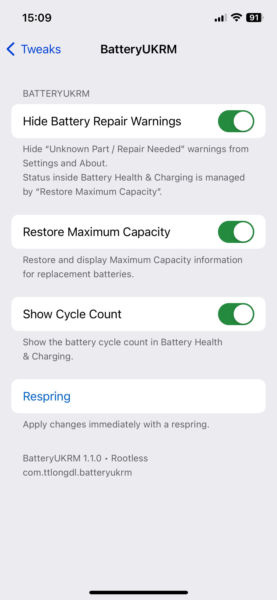
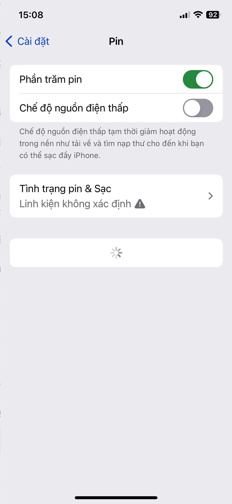

# BatteryUKRM

**English** | [Tiếng Việt](#tiếng-việt)

**BatteryUKRM** is a free rootless jailbreak tweak for iPhones with replacement batteries. It can hide battery-related **Unknown Part / Repair Needed** warnings, restore the native **Maximum Capacity** display on supported devices, and show the **real battery cycle count** in Settings.

**Version:** 1.1.0 · **Package:** `com.ttlongdl.batteryukrm` · **Jailbreak:** Rootless

> BatteryUKRM changes how battery information and warnings appear in iOS Settings. It does **not** repair a battery, authenticate replacement parts, or improve physical battery capacity. Compatibility depends on the device and iOS version.

## Features

| Feature | What it does |
| --- | --- |
| **Hide Battery Repair Warnings** | Hides battery-related “Unknown Part / Repair Needed” messages in Settings and About, including the Settings repair badge. |
| **Restore Maximum Capacity** | Restores the native Maximum Capacity / Battery Health presentation for supported replacement batteries. |
| **Show Cycle Count** | Reads the actual `CycleCount` from `AppleSmartBattery` and displays it in Battery Health & Charging. |

All three features have **independent switches** in **Settings → Tweaks → BatteryUKRM** and are enabled by default. Tap **Respring** to apply changes. Disabled modules do not install their corresponding hooks.

## Screenshots / Ảnh minh họa

The screenshots below show the **rootless** build on the tested iPhone 12 Pro. BatteryUKRM-RH shares the same preference design, but these screenshots do **not** constitute separate Roothide 1.1.0 testing.

Ảnh chụp từ bản **rootless** trên iPhone 12 Pro đã kiểm thử. Giao diện bản Roothide tương tự, nhưng các ảnh này **không** xác nhận bản Roothide 1.1.0 đã được kiểm thử độc lập.

| English | Tiếng Việt |
| :---: | :---: |
| **Preferences / Tùy chọn** | **Tùy chọn / Preferences** |
|  |  |
| **Battery Health & Cycle Count** | **Tình trạng pin & Số chu kỳ** |
|  |  |
| **Unknown Part warning (before)** | **Cảnh báo linh kiện (trước)** |
|  |  |

**Note:** The displayed **100% Maximum Capacity** and **19 cycles** are readings on the test device, not hard-coded or forced values.

## Tested configuration

- **Device:** iPhone 12 Pro
- **iOS:** 17.0
- **Jailbreak:** Dopamine rootless
- **Battery:** Replacement Apple battery, **without transplanting the original battery BMS/flex**

Other combinations may behave differently. A successful test on one device does not imply universal iOS support.

### Known limitation: iOS 17.7

A real-device report indicates that **Restore Maximum Capacity** may fail on iOS 17.7, leaving that section loading or unavailable. **Show Cycle Count** still worked in that report. If affected, turn **Restore Maximum Capacity** off and respring; the other modules can remain enabled.

**Display/screen repairs:** BatteryUKRM targets battery-related information. Hiding display-replacement warnings is not a verified feature.

## Installation and upgrades

Install the rootless BatteryUKRM package through your preferred compatible package manager, using a release package from this repository. After installation, open **Settings → Tweaks → BatteryUKRM**, select your options, then **Respring**.

Upgrading from **1.0.2** to **1.1.0** preserves the previous default behavior: all three switches start enabled.

## Tiếng Việt

**BatteryUKRM** là tweak miễn phí dành cho iPhone **jailbreak rootless**, tập trung vào việc khôi phục cách hiển thị thông tin pin sau khi thay pin, đồng thời ẩn các cảnh báo linh kiện pin không xác định trong Cài đặt.

**Phiên bản:** 1.1.0 · **Package:** `com.ttlongdl.batteryukrm`

> Tweak chỉ thay đổi cách iOS **hiển thị** thông tin và cảnh báo liên quan đến pin. Tweak **không sửa chữa pin**, không xác thực linh kiện thay thế và không làm tăng dung lượng thực tế của pin.

### Tính năng

| Tính năng | Mô tả |
| --- | --- |
| **Ẩn cảnh báo sửa chữa pin** | Ẩn cảnh báo “Linh kiện không xác định / Cần sửa chữa” liên quan đến pin trong Cài đặt và Giới thiệu, bao gồm biểu tượng cảnh báo sửa chữa. |
| **Khôi phục dung lượng tối đa** | Khôi phục mục Dung lượng tối đa / Tình trạng pin trên các cấu hình thay pin tương thích. |
| **Hiển thị số chu kỳ** | Đọc giá trị `CycleCount` thực từ `AppleSmartBattery` và hiển thị trong Tình trạng pin & Sạc. |

Ba tính năng có **công tắc riêng**, mặc định đều bật. Vào **Cài đặt → Tweaks → BatteryUKRM**, chọn tính năng cần dùng rồi nhấn **Respring**. Khi tắt một module, tweak sẽ không cài đặt các hook tương ứng của module đó.

Giao diện tùy chọn hỗ trợ **tiếng Việt và tiếng Anh** theo ngôn ngữ hệ thống.

### Thiết bị đã kiểm tra

- **iPhone 12 Pro**, **iOS 17.0**, **Dopamine rootless**
- Đã thay bằng pin Apple khác, **không chuyển mạch BMS/flex của pin gốc**

**Lưu ý iOS 17.7:** Có báo cáo thực tế cho thấy mục **Khôi phục dung lượng tối đa** có thể không hoạt động và bị xoay tải. Trong trường hợp này, hãy tắt riêng tính năng đó rồi respring. Tính năng hiển thị số chu kỳ vẫn hoạt động trên thiết bị được báo cáo.

**Màn hình thay thế:** Chưa xác minh khả năng ẩn cảnh báo liên quan đến màn hình. BatteryUKRM chỉ tập trung vào thông tin **pin**.

### Cài đặt / Nâng cấp

Cài gói **rootless** từ bản phát hành của repository bằng trình quản lý gói tương thích. Sau đó mở **Cài đặt → Tweaks → BatteryUKRM** và respring để áp dụng.

Nâng cấp từ **1.0.2** lên **1.1.0** sẽ giữ hành vi mặc định trước đây vì cả ba tính năng đều được bật sẵn.
